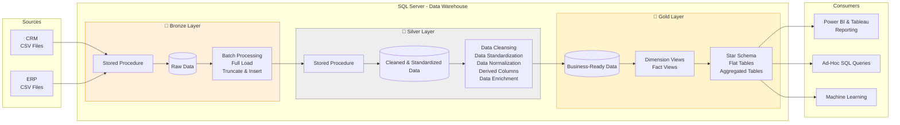

# 📊 Data Warehouse and Analytics Project

A complete end-to-end Data Warehouse and Analytics project built using
SQL Server. This project demonstrates how raw business data can be
transformed into a structured analytical data warehouse and used to
generate meaningful business insights.

---

#  Project Overview

The project focuses on building a modern data warehouse by integrating
data from multiple business sources such as ERP and CRM systems.

The workflow covers:

- Data extraction from CSV files
- Data cleaning and transformation
- Data integration
- Data warehouse development
- SQL-based analytics
- Business reporting and insights

The main objective is to create a reliable data platform that can support
business analysis and data-driven decision-making.

---

## 🎯 Project Objectives

- Build a structured data warehouse using SQL Server.
- Integrate data from ERP and CRM source systems.
- Clean and transform raw data before loading it into the warehouse.
- Design an analytical data model for reporting.
- Perform SQL-based exploratory and business analysis.
- Identify customer, product, and sales-related insights.

---

## 🏗️ Project Architecture

The project follows a simple ETL-based data warehouse architecture:


## 🏗️ High Level Architecture




### Data Sources

The project uses CSV files representing data from:

- ERP System
- CRM System

### Data Warehouse

SQL Server is used to store and manage the transformed data.

The warehouse is organized into analytical tables that make querying
and reporting easier.

---

## 🛠️ Technologies Used

- **SQL Server**
- **T-SQL**
- **CSV**
- **SQL Server Management Studio (SSMS)**
- **Git & GitHub**

---

## 🔄 Data Engineering Workflow

### 1. Data Extraction

Raw data is collected from ERP and CRM CSV files.

### 2. Data Cleaning

The raw data is checked for:

- Missing values
- Duplicate records
- Incorrect data types
- Invalid values
- Inconsistent formats

### 3. Data Transformation

The cleaned data is transformed into a consistent structure suitable
for analytical queries.

### 4. Data Integration

Data from different source systems is combined into a unified data model.

### 5. Data Warehouse

The transformed data is loaded into SQL Server.

### 6. Analytics

SQL queries are used to analyze:

- Customer behavior
- Product performance
- Sales trends

---

## 📈 Analytics

The analytical layer focuses on generating business insights from the
data warehouse.

### Customer Analysis

- Customer purchasing behavior
- Customer distribution
- Customer contribution to sales

### Product Analysis

- Product performance
- Product sales contribution
- Product-level trends

### Sales Analysis

- Sales trends
- Revenue analysis
- Sales performance over time

---

##  Project Structure

```text
Data-Warehouse-and-Analytics-Project/
│
├── datasets/
│   ├── source_crm/
│   └── source_erp/
│
├── sql/
│   ├── database/
│   ├── bronze/
│   ├── silver/
│   ├── gold/
│   └── analytics/
│
├── docs/
│   ├── data_model.png
│   └── architecture.png
│
├── README.md
└── LICENSE
